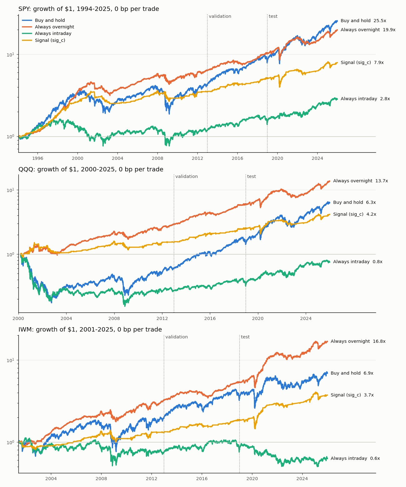

# Overnight vs intraday returns

Do US stocks earn their returns overnight, while the market is closed? And can a strategy that holds only overnight beat buy-and-hold once trading costs are counted?

The project covers SPY, QQQ and IWM from 1993 to 2025, with a train (1993-2012) / validation (2013-2018) / test (2019-2025) split. The final test was rerun after a methodology review, so it is not a clean holdout (see Limitations).

## Data

| File | Source |
|---|---|
| `crsp_daily.csv` | CRSP v2 daily stock file via WRDS: open, high, low, close, closing bid and ask, total and ex-dividend return, volume, cumulative price factor, by PERMNO (SPY 84398, QQQ 86755, IWM 88222) |
| `wrds_vix.csv` | Cboe VIX daily close, via WRDS |
| `wrds_tbill3m.csv` | Federal Reserve H.15 3-month T-bill (secondary market, `dtb3`), via WRDS, up to 2025-02-13 |
| `fred_dtb3_extension.csv` | The same series from FRED (`DTB3`), 2025-02-12 to 2025-12-31, after the WRDS copy ends |

**The data are not included.** CRSP data may not be redistributed under the WRDS licence. `data/raw/manifest.csv` records each file's source, date range, row count and SHA-256.

## Method

- **Cleaning:** CRSP is matched on PERMNO, so ticker changes (QQQ was QQQQ in 2004-2011) do not break the series. Bad prices, stale opens, half-days and extreme moves are flagged rather than silently dropped.
- **Returns:** each day is split into overnight (close to next open) and intraday (open to close) total returns, and the split is checked to recombine exactly into close-to-close returns. The T-bill return goes on the overnight leg.
- **Signals and tests:** three overnight signals and two combinations, each tested for look-ahead and fixed before any returns were examined. Hypotheses are tested on the train sample with Newey-West and Driscoll-Kraay standard errors, with and without flagged days, and Holm-adjusted across signals.
- **Backtest engine:** in-or-cash for each leg, T-bill interest on cash, flat per-trade costs of 0-10 bp plus the CRSP closing quoted half-spread, breakeven costs, and a 1,000-draw random-night placebo.
- **Validation and final test:** a rule fixed before the run picks one signal on 2013-2018 (the best average Sharpe at 1 bp per trade across the three ETFs). The 2019-2025 test is then run with the signal, engine, costs and test code committed beforehand.
- **Robustness:** descriptive checks on the full sample (by era, without the best days, weekends, walk-forward re-pick, bootstrap intervals for Sharpe), none of them feeding back into any decision.

## Findings

- **The train sample has an overnight premium.** From each ETF's inception through 2012, overnight minus intraday excess return is 3.25 bp a day for SPY, 8.82 bp for QQQ and 5.62 bp for IWM. The effect is concentrated before 2008.
- **The train signals are weak.** None of the five conditional signals reliably beats random nights after multiple-testing adjustment. Two of them beat always-overnight on QQQ, but none does on SPY or IWM.
- **The fixed validation rule selects `sig_c`** (VIX above its one-year median at the previous close). At 1 bp per trade its mean validation Sharpe across the three ETFs is 0.595, compared with 0.407 for the runner-up `sig_ac`.
- **Costs are decisive.** In train, always-overnight breaks even with cash at only 1.23-1.65 bp per trade. In the test it breaks even at 1.3-2.7 bp, and it beats buy-and-hold only on IWM below 1.25 bp.
- **The chosen signal has no edge in the final test (2019-2025).** Before costs `sig_c` earns 6.36% a year on SPY, 7.20% on QQQ and 10.51% on IWM. That puts it at the 58th, 52nd and 63rd percentile of random sets of nights, below always-overnight and below or equal to buy-and-hold (17.2%, 22.7% and 10.5%).
- **The overnight gap has shrunk for SPY and QQQ.** In 2021-2025 it is -1.0 and -0.1 bp a day, against 3.3 and 8.8 bp in train, although the change from train is not significant at 5% (p = 0.18 for SPY, 0.06 for QQQ). IWM keeps 6.1 bp a day, which is not significant either.

## How to run

1. Download the raw files from WRDS with the web query forms (output CSV, uncompressed, dates as YYYY-MM-DD) and save them in `data/raw/` under the names above:
   - `crsp_daily.csv`: CRSP > Annual Update > Stock - Version 2 (CIZ) > Daily Stock File, PERMNOs 84398, 86755 and 88222, 1993-01-01 to 2025-12-31, variables `PERMNO`, `HdrCUSIP`, `Ticker`, `PERMCO`, `DlyCalDt`, `DlyPrc`, `DlyRet`, `DlyRetx`, `DlyVol`, `DlyClose`, `DlyLow`, `DlyHigh`, `DlyBid`, `DlyAsk`, `DlyOpen`, `DlyCumFacPr`, `DlyCumFacShr`.
   - `wrds_vix.csv`: Cboe Options > Cboe Indexes, 1993-01-01 to 2026-09-30, variables `date`, `vix`, `vixo`, `vxn`.
   - `wrds_tbill3m.csv`: Federal Reserve Board Reports > Interest Rates > Interest Rate Daily, 1993-01-01 to 2025-02-13, variables `date`, `dtb3`.
   - `fred_dtb3_extension.csv`: FRED series `DTB3` from 2025-02-12 to 2025-12-31, saved with columns `date`, `dtb3`.
2. `pip install -r requirements.txt`
3. The notebook checks the files against `data/raw/manifest.csv`. A new export can differ byte for byte (for example after a CRSP update); in that case run `python src/manifest.py` to record your own files.
4. Create the saved final-test run once: `python src/checks.py crsp && python src/returns.py && python src/signals.py && python src/test_period.py run`.
5. Open `notebook.ipynb` from the repository folder and choose **Restart & Run All**. Each step writes a detailed report to `reports/`.

Each step can also be run as a script from `src/` (`checks.py`, `returns.py`, `signals.py`, `hypothesis_tests.py`, `backtest.py`, `validation.py`, `test_period.py report`, `robustness.py`). `python -m unittest discover tests` runs the tests.

## Limitations

CRSP has a few missing opens, duplicate source rows and crossed closing quotes. These are reported explicitly: unconstructable return legs are excluded from open-to-close backtests, missing signal inputs stay in cash, and crossed quotes carry the last valid non-negative half-spread. Signals use data up to the previous close, because the same day's close and VIX are not known in time for a market-on-close order.

**The 2019-2025 results are not a clean out-of-sample test.** The final test was first run with same-close signals (validation picked `sig_b`, which had no edge in the test). After a review, the signals were moved to the previous close and the flagged-day checks were limited to data problems. Validation then picked `sig_c`, and the test was run again. Both changes fix real problems, but they were made after the test results were known.
